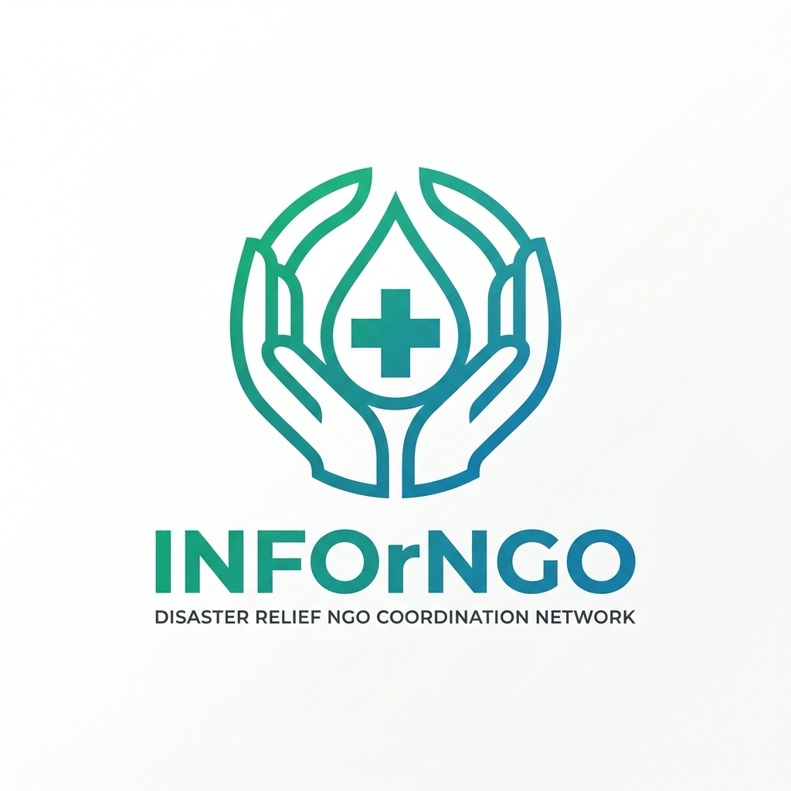

# INFOrNGO - Disaster Relief Mesh & Real-Time Humanitarian Grid

<p align="center">
  
</p>

<p align="center">
  <strong>দুর্যোগে প্রতিটি এলাকায় সুষম ত্রাণ বণ্টন ও সমন্বিত নিড-ট্র্যাকার</strong><br>
  <em>Equitable Relief Distribution & Unified Need Progression Mesh for Bangladesh</em>
</p>

<p align="center">
  <a href="https://kazitahmidurrahman01-boop.github.io/inforngo/"></a>
  
  
</p>

---

## 🌐 Live Web Application

- **Live Platform URL**: [https://kazitahmidurrahman01-boop.github.io/inforngo/](https://kazitahmidurrahman01-boop.github.io/inforngo/)
- **Public GitHub Repository**: [https://github.com/kazitahmidurrahman01-boop/inforngo](https://github.com/kazitahmidurrahman01-boop/inforngo)

---

## 📌 Problem Statement

During catastrophic floods and disasters in Bangladesh (e.g., Feni, Noakhali, Khulna, Chittagong):
1. **Relief Duplication & Over-saturation**: Accessible roadside shelters receive 500% more rations than needed, leading to spoilage and hoarding.
2. **Starvation in Isolated Pockets**: Cut-off villages and remote wards remain at 0% assistance for days without anyone tracking the deficit.
3. **Lack of Ground Evidence**: Donors lack verified field photographs and real-time transit status of dispatch fleets.
4. **Duplicate Claims**: Without a centralized victim roster, the same households claim relief multiple times while neighboring vulnerable families receive nothing.

---

## 💡 The Solution: INFOrNGO

**INFOrNGO** solves this coordination crisis by connecting grassroots field scouts directly with donor NGOs, ministries, and logistics fleets through a unified digital coordination grid.

### 🚀 Key Features

### 1. 🤝 Relief Booking Dashboard (ত্রাণ বুকিং ড্যাশবোর্ড)
- Live disaster zone cards with authentic, verified flood photographs.
- **Dynamic Need Progression Bars**: Visual breakdown of Dry Food, Drinking Water, Medical Kits, and Baby Food.
- Clickable unfulfilled segments allowing registered donor NGOs to commit and book aid with 1-click.
- Prevents over-booking: once an item reaches 100%, pledges are locked.

### 2. 📢 Grassroots Post Need Form with Gallery Upload (চাহিদা পোস্ট ফরম)
- Dedicated intake portal for local volunteers and scouts on the ground.
- **Device & Gallery Photo Upload**: Field scouts can upload real flood and storm damage photos directly from their phone/PC gallery with automatic client-side canvas optimization.
- Instantly publishes newly verified crisis zones with 0% needbars on the live grid.

### 3. 🧠 Smart AI Relief Allocation Engine (স্মার্ট এআই ত্রাণ ম্যাচিং)
- Donor organizations specify their warehouse inventory (e.g., 1,000 food boxes, 500 water cartons).
- The algorithm calculates optimal multi-zone distribution prioritizing deepest deficits and life-threatening water levels.
- 1-click approval and auto-booking.

### 4. 🚚 Live Convoy GPS Fleet Tracker & Digital Gate Pass (কনভয় ট্র্যাকার ও ছাড়পত্র)
- Real-time vehicle speed (km/h), live checkpoint locations, and route completion progress.
- Generates official, printable **Digital Relief Transit Passes** (`INFOR-PASS-2026`) with security tokens.

### 5. 👥 Disaster Victim Family Aid Registry & Anti-Duplication Checker (পরিবার তালিকা ও ডুপ্লিকেট রোধ)
- Centralized token registry searchable by Family Head Name, National ID (NID), or Family Token.
- Real-time audit history of previously received assistance to eliminate duplicate claiming in shelters.

### 6. 📜 Public Cryptographic Relief Ledger (পাবলিক ত্রাণ অডিট লেজার)
- Blockchain-style immutable transaction stream with simulated **SHA-256** hash verification for every dispatched consignment.
- Real-time financial valuation audit.

### 7. 🗺️ Leaflet GIS Flood Inundation Map (প্লাবন ম্যাপ)
- Humanitarian-styled OpenStreetMap layer displaying disaster clusters, water depths, and color-coded status pins.

### 8. 🌐 1-Click Bilingual Language Switcher (বাংলা ⇄ English)
- Seamless toggling between standard Bengali and international English across all views, modals, and tables.

### 9. 🔘 Three-Dots (⋮) Modern Navigation Menu
- Clean top-right kebab menu (`⋮`) providing rapid access to all 11 core and advanced tools formatted as tactile buttons.

---

## 🛠️ Tech Stack

- **Frontend**: Semantic HTML5, CSS3, Modern ES6+ JavaScript
- **Styling**: Tailwind CSS, Custom Off-White Design System
- **Iconography**: Lucide Vector Icons
- **Mapping**: Leaflet.js with Humanitarian OpenStreetMap tiles
- **Image Optimization**: Client-side HTML5 Canvas downscaling
- **Hosting**: GitHub Pages (Continuous Deployment from `main`)

---

## 📂 Project Structure

```text
INFOrNGO/
├── assets/
│   └── logo.png              # Official Humanitarian Emblem Vector Logo
├── css/
│   └── style.css             # Off-white NGO theme and drawer animations
├── js/
│   ├── app.js                # Core state, bilingual i18n, router & features
│   └── data.js               # Bangladesh crisis dataset, convoy telemetry & ledger
├── index.html                # Single-page application entry point
└── README.md                 # Project documentation
```

---

## 📄 License & Attribution

This project is open-source and created for humanitarian crisis coordination and disaster relief management in Bangladesh.

**Website**: [https://kazitahmidurrahman01-boop.github.io/inforngo/](https://kazitahmidurrahman01-boop.github.io/inforngo/)
